<!-- Animated Header -->

  

  

  

---

###  About Me

<b>Click to expand my bio</b>

 
🎂 Born in <b>2002</b> (Proud Gen Z Coder!) 
💻 Junior <b>Front-End Developer</b> passionate about pixel-perfect, accessible UIs. 
🔄 Currently <b>between jobs</b>, leveling up in <b>Prompt Engineering</b>. 
🎨 I love bridging beautiful <b>UI Design</b> and clean <b>Code</b>. 
🐾 Fun fact: I have <b>2 cats</b> actively "debugging" my life.

---

### 🛠️ Tech Stack & Tools

  
  
  
  
  
  
  
  
  <!--
  
  
  -->

---

### 📊 GitHub Dashboard

<!--
  These 3 cards are made by my own GitHub Action (scripts/generate_cards.py).
  They update every 6 hours and do not need any other website.
-->

  

  
  

---

### 🏆 GitHub Trophies

  

---

### 🐍 Contribution Snake

  <picture>
    <source media="(prefers-color-scheme: dark)" srcset="https://raw.githubusercontent.com/Majnoon-MH/Majnoon-MH/output/snake-neon.svg" />
    <source media="(prefers-color-scheme: light)" srcset="https://raw.githubusercontent.com/Majnoon-MH/Majnoon-MH/output/snake.svg" />
    
  </picture>

---

### 📫 Let's Connect!

  
  
  

  

